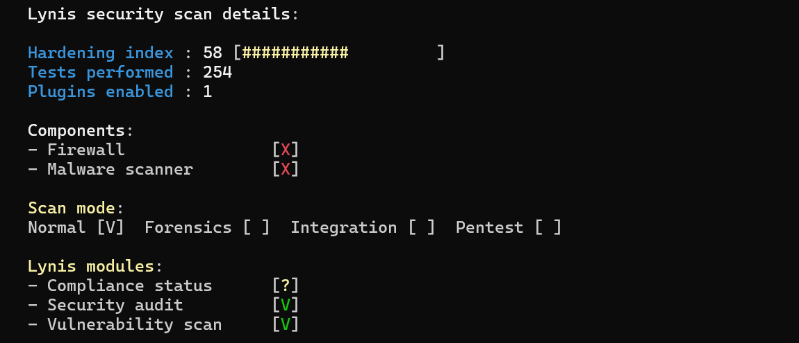
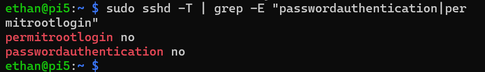
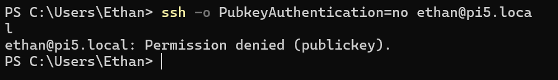

# Raspberry Pi 5 Linux Hardening

Securing a fresh Raspberry Pi OS install the way you would prepare a server for production, and measuring the improvement with [Lynis](https://cisofy.com/lynis/), an open source security auditing tool.

**Status:** In progress

## Goal
Take a default Linux install, apply common hardening steps, and prove each one works by testing it.

## Setup
- **Hardware:** Raspberry Pi 5
- **OS:** Raspberry Pi OS Lite (64-bit), headless
- **Access:** SSH from a Windows laptop
- **Raspberry Pi Connect:** left off on purpose to keep remote access paths to a minimum

## 1. Baseline Audit
Ran Lynis on the fresh install before making any changes.

**Starting hardening index: 58**

Lynis also flagged that no firewall or malware scanner was installed.



## 2. SSH Key Authentication
Passwords can be brute forced, so I switched SSH to key based login only.

- Generated an **ed25519** key pair on my laptop, protected with a passphrase
- Copied the public key to the Pi
- Disabled password logins with a drop-in config file at `/etc/ssh/sshd_config.d/00-hardening.conf`:

```
PasswordAuthentication no
KbdInteractiveAuthentication no
PermitRootLogin no
PubkeyAuthentication yes
MaxAuthTries 3
X11Forwarding no
```

**Something I found:** the Raspberry Pi Imager had created `50-cloud-init.conf` with `PasswordAuthentication yes`. SSH reads drop-in files in alphabetical order and keeps the first value it sees, so I named my file `00-hardening.conf` so it loads first and wins. I confirmed the effective settings with `sshd -T`.



**Test:** forcing a password login is now refused, and only public key login is accepted.



## 3. Firewall (UFW)
Set up a default deny firewall that only allows what is needed.

- Deny all incoming, allow outgoing
- Allow SSH with rate limiting (blocks IPs that try 6+ connections in 30 seconds)
- Allowed SSH **before** enabling the firewall to avoid locking myself out

```
Status: active
Logging: on (low)
Default: deny (incoming), allow (outgoing), disabled (routed)

To                         Action      From
--                         ------      ----
22/tcp                     LIMIT IN    Anywhere
22/tcp (v6)                LIMIT IN    Anywhere (v6)
```

## Next Steps
- [ ] fail2ban to automatically ban IPs after failed logins
- [ ] Automatic security updates
- [ ] Disable unused services
- [ ] auditd for system event logging
- [ ] Rerun Lynis and compare to baseline
